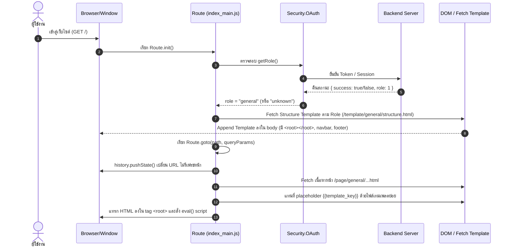

# เอกสารสถาปัตยกรรม SPA Routing, การทำ Authentication และการดึงข้อมูลเชิงโครงสร้าง (SKAAI)

เอกสารนี้รวบรวมและวิเคราะห์สถาปัตยกรรมของโปรเจกต์ **SKAAI** โดยเน้นไปที่ระบบ Client-side Single Page Application (SPA) Routing, ขั้นตอนการตรวจสอบสิทธิ์ (Authentication & Role Authorization) และกระบวนการดึงไฟล์โครงสร้าง/เทมเพลต (Structural Template Fetching & Rendering)

---

## 1. ภาพรวมโครงสร้างโฟลเดอร์ของโปรเจกต์ (Folder Structure)

โครงสร้างโฟลเดอร์ถูกแบ่งออกเป็น 2 ส่วนหลัก คือ **Frontend** (SPA & PWA) และ **Backend** (FastAPI):

```
SKAAI/
├── Backend/                            # REST API Backend (FastAPI, PyTorch, MediaPipe)
│   ├── req_class/                      # Pydantic Schemas / Request Data Classes
│   │   ├── account.py
│   │   ├── oauth.py
│   │   └── pose.py
│   ├── routes/                         # API Endpoints
│   │   ├── account.py                  # ข้อมูลบัญชีผู้ใช้
│   │   ├── oauth.py                    # ตรวจสอบสิทธิ์และรับ Token / Code
│   │   └── pose.py                     # ข้อมูลท่าและประมวลผลท่ารำ
│   ├── ai.py                           # โมเดล AI คัดกรองและประเมินท่าทาง
│   ├── database.py                     # การเชื่อมต่อฐานข้อมูล
│   ├── env.py                          # ค่าตัวแปรสิ่งแวดล้อม (.env config)
│   ├── main.py                         # FastAPI Application Entrypoint
│   └── security.py                     # Security, Password Hashing, JWT/Session
│
├── Frontend/                           # Client-side Single Page Application (SPA)
│   ├── main/                           # เว็บแอปพลิเคชันสำหรับ Desktop / Main Web
│   │   ├── asset/                      # รูปภาพ, manifest.json, สไตล์ CSS กลาง (var.css)
│   │   ├── library/                    # สคริปต์หลักของระบบ SPA Routing & Auth
│   │   │   ├── index_main.js           # Core Routing, OAuth & Rendering Engine ของ main
│   │   │   └── index_pwa.js            # Core Routing สำหรับ PWA
│   │   ├── page/                       # หน้าเว็บเนื้อหาหลัก แยกตามระดับสิทธิ์ (Role)
│   │   │   ├── general/                # หน้าสำหรับผู้ใช้งานทั่วไปที่ล็อกอินแล้ว (index, exercises, setting, etc.)
│   │   │   └── unknown/                # หน้าสำหรับผู้ใช้ที่ยังไม่ได้ล็อกอิน (login, register, reset-password, oauth)
│   │   ├── template/                   # ชิ้นส่วนโครงสร้างและคอมโพเนนต์ย่อย
│   │   │   ├── general/                # structure.html, navbar.html, footer.html, js template
│   │   │   └── unknown/                # structure.html, navbar.html, footer.html สำหรับ guest
│   │   ├── index.html                  # Shell SPA Page หลัก (โหลด index_main.js)
│   │   ├── privacy-policy.html
│   │   └── term-and-condition.html
│   │
│   └── pwa/                            # โมดูลเว็บเวอร์ชัน Progressive Web App (โครงสร้างคล้าย main)
│       ├── page/
│       ├── template/
│       └── index.html
│
└── requirements.txt                    # Dependencies ของ Python
```

---

## 2. กลไกการทำ Authentication & Role-Based Access Control

การจัดการ Authentication ถูกขับเคลื่อนผ่านออบเจกต์ `Security.OAuth` ในไฟล์ [index_main.js](file:///c:/Users/Adiluk/SKAAI/Frontend/main/library/index_main.js):

### 2.1 แหล่งที่มาของข้อมูลการล็อกอิน (Credential Priority)
ระบบจะตรวจสอบ Credentials ที่ถูกเก็บไว้ใน `window.localStorage` ตามลำดับความสำคัญ:
1. **Google Token (`signin-token`)**: ส่ง POST ไปยัง `/oauth/google`
2. **Google Auth Code (`signin-code`)**: ส่ง POST ไปยัง `/oauth/google-code`
3. **อีเมลและรหัสผ่าน (`signin-email`, `signin-password`)**: ส่ง POST ไปยัง `/oauth`

```javascript
// ตัวอย่างตรรกะใน Security.OAuth.getInfo()
let token = window.localStorage.getItem(SETTING.LocalStorage.Login.token);
if (token) {
  // ส่งไปตรวจสิทธิ์ด้วย Google Token
  return await fetch(SETTING.Server + "/oauth/google", { ... });
}

let code = window.localStorage.getItem(SETTING.LocalStorage.Login.code);
if (code) {
  // ส่งไปแลกเปลี่ยนสิทธิ์ด้วย OAuth Code
  return await fetch(SETTING.Server + "/oauth/google-code", { ... });
}

let email = window.localStorage.getItem(SETTING.LocalStorage.Login.email);
let password = window.localStorage.getItem(SETTING.LocalStorage.Login.password);
if (email && password) {
  // ตรวจสอบ Username/Password ปกติ
  return await fetch(SETTING.Server + "/oauth", { ... });
}

return { success: false };
```

### 2.2 การจำแนกบทบาทผู้ใช้ (Role Mapping)
ระบบมี Role หลัก 3 ประเภทตาม `RoleList`:
* `unknown` (Guest ที่ยังไม่ล็อกอิน หรือ Token ไม่ถูกต้อง)
* `general` (ผู้ใช้งานทั่วไปที่ยืนยันตัวตนสำเร็จ)
* `admin` (ผู้ดูแลระบบ)

ฟังก์ชัน `Security.OAuth.getRole()` จะคืนค่าบทบาทของผู้ใช้ เพื่อนำไปใช้เป็น Namespace ในการค้นหา Route และ Template ถัดไป:
```javascript
getRole: async () => {
  return await Security.OAuth.getInfo().then((info) => {
    if (!info.success) return RoleList.unknown;
    return Object.values(RoleList)[info.role];
  });
}
```

---

## 3. สถาปัตยกรรม SPA Routing และการทำงานของระบบ Route

โปรเจกต์นี้ไม่ได้ใช้ Third-party Routing Framework (เช่น React Router หรือ Vue Router) แต่ใช้ **Custom SPA Router ที่สร้างด้วย Vanilla JavaScript** ผ่าน `window.history.pushState` ร่วมกับ DOM Shell (`<root></root>`):



---

## 4. กระบวนการดึงข้อมูลเชิงโครงสร้างและเทมเพลต (Structural Template Fetching)

จุดเด่นของระบบนี้คือ **Component Template Composition แบบ HTML-in-HTML** โดยใช้ Syntax Placeholder เช่น `{{navbar}}`, `{{footer}}`, `{{structure_script}}`:

### ขั้นตอนที่ 1: การโหลดโครงสร้างแม่แบบ (Default Structure)
เมื่อโหลดหน้าครั้งแรก (`Route.init()`):
1. ตรวจสอบ Role ของผู้ใช้จาก `Security.OAuth.getRole()`
2. ดึงไฟล์ Structure กลางผ่านพาธ `SETTING.DefaultElement[role].structure` (เช่น `Frontend/main/template/general/structure.html`)
3. วนลูปอ่าน Sub-template ที่ประกาศไว้ใน `SETTING.DefaultElement[role].template`:
   * แทนที่ `{{navbar}}` ด้วยเนื้อหาของ `navbar.html`
   * แทนที่ `{{footer}}` ด้วยเนื้อหาของ `footer.html`
4. ผนวก DOM เข้าสู่ `document.body` เพื่อสร้างโครง layout และแท็ก container `<root></root>`

### ขั้นตอนที่ 2: การโหลดหน้าและคอมโพเนนต์ย่อยของหน้านั้น (`Route.goto`)
เมื่อมีการเปลี่ยน URL ผ่าน `Route.goto(page_path, params)`:
1. ตรวจสอบสิทธิ์และรับ Role ล่าสุด
2. ตรวจสอบว่าหน้าปลายทางมีสิทธิ์เข้าถึงใน Role นั้นหรือไม่ผ่านตาราง `SETTING.Route[role][page]`:
   * หากไม่มี route ใน role นั้น จะสั่งเปลี่ยนเส้นทางไปยังหน้า 404 (`Route.goto(404)`)
3. อัปเดต URL บนแถบ Address Bar ของเบราว์เซอร์ด้วย `window.history.pushState`
4. ทำการ `fetch()` ไฟล์ HTML ประจำหน้า เช่น `page/general/exercises.html`
5. อ่านค่า `RouteList[role][page].template`:
   * หากพบ string placeholder ในรูปแบบ `{{passkey}}` (เช่น `{{structure_script}}`, `{{exhead}}`) ตัว Router จะ fetch เทมเพลตนั้นมาแล้วใช้ `Regex.replace` แทนที่ลงในเนื้อหา
6. นำ HTML สำเร็จรูปแทรกลงในแท็ก `<root></root>`
7. **Script Execution Parsing**:
   * ค้นหาแท็ก `<script>` ภายใน DOM ของ Navbar, Footer และ Root
   * หากเป็น Inline Script จะสั่ง `eval(script.innerText)`
   * หากมี attribute `src` จะสั่ง `fetch(script.src)` แล้วนำเนื้อหามา execute ด้วย `eval()`
   * ลบแท็ก `<script>` ต้นฉบับออกจาก DOM เพื่อความปลอดภัยและไม่ให้ทำงานซ้ำซ้อน

---

## 5. ตารางเปรียบเทียบ Page Routing ตามบทบาท (Access Matrix)

| เส้นทาง (Route Path) | สิทธิ์ `unknown` (Guest) | สิทธิ์ `general` (Member) | ไฟล์ Template หน้า |
| :--- | :--- | :--- | :--- |
| `/` | เข้าได้ (General Index) | เข้าได้ (General Index) | `general/index.html` |
| `/login` | เข้าได้ | **404 / ไม่มี Route** | `unknown/login.html` |
| `/register` | เข้าได้ | **404 / ไม่มี Route** | `unknown/register.html` |
| `/google-oauth` | เข้าได้ | **404 / ไม่มี Route** | `unknown/google-oauth.html` |
| `/exercises` | โหมดดูข้อมูลเบื้องต้น | เข้าได้เต็มรูปแบบ | `general/exercises.html` |
| `/exercise-tutorial` | ใช้งานได้ | ใช้งานได้ | `general/exercise-tutorial.html` |
| `/exercise-scored` | **ไม่มีสิทธิ์ (404)** | เข้าได้ | `general/exercise-scored.html` |
| `/setting` | **ไม่มีสิทธิ์ (404)** | เข้าได้ | `general/setting.html` |
| `/logout` | **ไม่มีสิทธิ์ (404)** | เข้าได้ | `general/logout.html` |

---

## 6. สรุปข้อดีและข้อควรระวังของสถาปัตยกรรมนี้

### ข้อดี (Advantages)
1. **Lightweight & No Build Step**: ไม่จำเป็นต้องพึ่ง Node.js, Webpack, Vite หรือ Framework ขนาดใหญ่ สามารถรันไฟล์ HTML/CSS/JS บริสุทธิ์ได้ทันที
2. **Dynamic Role-based View Splitting**: แบ่งแยกมุมมองหน้าของผู้ใช้งาน (Guest vs Logged-in) อย่างชัดเจนตั้งแต่ระดับ Routing Config
3. **Template Reusability**: มีระบบ Template Placeholder (`{{key}}`) ช่วยลดความซ้ำซ้อนของโค้ด เช่น Navbar, Footer, Exercise Head

### ข้อควรระวัง (Considerations & Best Practices)
1. **การใช้ `eval()` สำหรับ Script Execution**: แม้จะทำให้รัน Script หลังโหลด HTML ได้สะดวกรวดเร็ว แต่ควรระวังเรื่อง XSS Injection ในหน้าเว็บที่มี User-generated Content
2. **การจัดเก็บ Credential ใน LocalStorage**: การเก็บ Plain password ไว้ใน `localStorage` อาจมีความเสี่ยงด้านความปลอดภัย แนะนำให้เปลี่ยนเป็นการรับ Session/Refresh Token หรือ Cookie แบบ `HttpOnly` แทน

